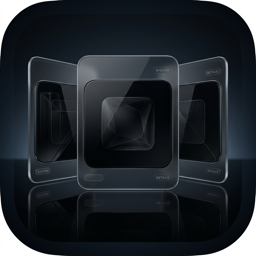

# AppsChannel

<p align="center">
  
</p>

<p align="center">
  <strong>The classic magic of 3D Cover Flow meets the Nintendo Wii &amp; 3DS Channel Grid — reimagined as a modern, ultra-responsive macOS launcher with Apple Liquid Glass aesthetics.</strong>
</p>

<p align="center">
  <a href="https://github.com/micah1crandell/AppsChannel/releases/latest"></a>
  <a href="https://github.com/micah1crandell/AppsChannel/actions/workflows/ci.yml"></a>
  
  
  
  
  <a href="LICENSE"></a>
</p>

---

AppsChannel is a lightweight, hardware-accelerated macOS application launcher built entirely with SwiftUI and AppKit. It combines the tactile nostalgia of mid-2000s Cover Flow and gaming consoles with modern macOS design: native behind-window desktop blur, smooth spring physics, usage-based smart ranking, and customizable global shortcuts.

---

## Features

### 1. Four Visual Layout Modes (`⌘V`)
- **Minimalist 3D App Icon Flow**: Pure macOS application icons in a classic 3D Cover Flow carousel with perspective tilt, vibrant dynamic accent lighting, and specular mirror floor reflections.
- **3D Channel Cards Flow**: Classic Nintendo Wii & macOS Channel cards with category tags, status badges, and specular reflections.
- **Curved Cylindrical Wall Grid**: 3-row curved interactive wall inspired by classic console channel grids, featuring cylindrical perspective math and dynamic slot badges.
- **Nintendo 3DS Flat Grid**: Flat paginated channel grid (configurable from 1 to 5 horizontal rows) with turquoise reticle cursor and dynamic title banner.

### 2. Dual Launcher Experiences
- **Quick Launcher (`⌥L`)**: A floating, spotlight-like liquid glass HUD that blends seamlessly into your desktop with a soft feathered blur. Appears instantly, dismisses on click-out or `Esc`.
- **Main App Window**: A full frameless macOS liquid glass window with native traffic lights, resizability, and drag-anywhere background support.

### 3. Retro Sound Themes & Force Touch Haptics
- **Tactile Audio Themes**: Choose between *Subtle Classic*, *Playful Pop*, and *Mechanical Click* for card selection, navigation, and launch feedback.
- **Instant Audio Preview**: Audition themes directly in Preferences with live auditory feedback.
- **Force Touch Trackpad Haptics**: Subtle physical alignment pulses on Apple trackpads synchronized with card navigation.

### 4. Menu Bar Integration
- Runs unobtrusively in your macOS menu bar without cluttering the Dock (`LSUIElement`).
- Single click toggles the main window; right-click opens quick controls, settings, and cache management.
- Quick Launcher includes a dedicated button pinned at the far right to transition seamlessly into the main window.

### 5. Smart Usage-Based "Middle-Out" Ranking
- **Center-Fan Architecture**: Your most-used application is automatically placed at the center (Rank #1). Ranks radiate outward (#2 right, #3 left, #4 right, #5 left), so your favorites are immediately in focus on launch.
- **Associative Search Memory**: Remembers what apps you open for specific queries (e.g. searching `"code"` and launching *Visual Studio Code* will prioritize it over alphabetical matches).
- **Persistent Analytics**: Tracks launch frequency and recency locally with zero telemetry or network calls.

### 6. Nintendo Wii / 3DS Channel Arranger
- Enter **Organize Mode** to freely rearrange channels.
- Move cards left, right, or pin to the front with custom order persistence (`UserDefaults`).
- Reset anytime to usage-based smart order or alphabetical order in Settings.

### 7. Running Indicators & Quick Actions
- **Active Process Dots**: Glowing ambient green indicators reactively surface applications currently executing in system memory.
- **Context Actions (Right-Click / Keyboard)**:
  - *Reveal in Finder* (`⌘⇧R` or `⌘R`)
  - *Get Info* (`⌘I`)
  - *Copy Path & Bundle ID*
  - *Quit / Force Quit Application* for active processes
  - *Hide Application* from the grid

### 8. Multi-Display & Accessibility Ergonomics
- **Pointer-Targeted Display Spawning**: Automatically detects which monitor contains your mouse cursor to present the HUD on your active screen without jumping to primary displays.
- **Reduce Motion Compliant**: Automatically adapts 3D transforms, perspective spins, and spring physics when *Reduce Motion* is enabled in macOS Accessibility.
- **VoiceOver Ready**: Comprehensive accessibility labels, traits, and hints for all cards and actions.

### 9. Power-User Keyboard & Gesture Shortcuts
| Shortcut | Action |
| :--- | :--- |
| `⌥L` | Toggle Quick Launcher from anywhere in macOS (customizable) |
| `⌘V` | Cycle between Cover Flow, Wall Grid, and 3DS Grid |
| `⌘⇧R` | Reveal currently focused application in Finder |
| `⌘I` | Open macOS Finder Get Info window for focused app |
| `⌥1` – `⌥9` | Direct Launch Channel Slots 1 through 9 |
| `⌘1` – `⌘8` | Instant Category Group Switching (Dev, Productivity, Design, etc.) |
| `⌘O` | Switch from Quick Launcher to Main App Window |
| `⌘,` | Open Settings & Analytics Modal |
| `⌘W` | Close current window |
| `←` / `→` / Trackpad Scroll | Smooth carousel navigation |
| `Return` / Click | Launch selected application |

---

## Architecture & Tech Stack

- **Platform**: macOS 14.0+ (Sonoma, Sequoia)
- **Frameworks**: SwiftUI, AppKit, SceneKit, Combine
- **Dependencies**: 
  - [HotKey](https://github.com/soffes/HotKey) (SPM package for global keyboard event registration)
  - [Sparkle](https://github.com/sparkle-project/Sparkle) (SPM package for secure GitHub Releases auto-updating)
- **Rendering**: SwiftUI hardware-accelerated 3D transforms (`rotation3DEffect`, `scaleEffect`, `VisualEffectBackground`)
- **Data & Caching**: Multi-tier local disk persistence (`apps_cache.json`, `usage_analytics.json`)

---

## Installation

### Via Homebrew (Recommended)
```bash
brew tap micah1crandell/appschannel https://github.com/micah1crandell/AppsChannel
brew install --cask appschannel
```

### Direct Download
Download the latest `.dmg` or `.zip` directly from [GitHub Releases](https://github.com/micah1crandell/AppsChannel/releases). Once installed, AppsChannel updates itself automatically via built-in Sparkle updates.

---

## Getting Started

### Prerequisites
- macOS 14.0 or newer
- Xcode 15.0 or newer
- Swift 5.9+

### Building from Source

1. **Clone the repository:**
   ```bash
   git clone https://github.com/micah1crandell/AppsChannel.git
   cd AppsChannel
   ```

2. **Open in Xcode:**
   ```bash
   open AppsChannel.xcodeproj
   ```

3. **Or build via Terminal:**
   ```bash
   xcodebuild -scheme AppsChannel -destination 'platform=macOS' -derivedDataPath ./build build
   ```

4. **Run the built application:**
   ```bash
   open ./build/Build/Products/Debug/AppsChannel.app
   ```

---

## Configuration & Permissions

- **Accessibility**: When configuring custom global hotkeys, macOS may request Accessibility permissions under *System Settings > Privacy & Security > Accessibility*.
- **Menu Bar**: The app runs as an accessory status item. Click the menu bar icon or press `⌥L` to activate the launcher.

---

## Contributing & Community

Contributions, bug reports, and feature suggestions are welcome!
- 🗺️ Read our [Product Roadmap](ROADMAP.md) to see active and planned initiatives.
- 🛠️ Follow the [Contributing Guide](CONTRIBUTING.md) to get set up locally.
- 🔒 For security disclosures, refer to our [Security Policy](SECURITY.md).

---

## License

Distributed under the MIT License. See [`LICENSE`](LICENSE) for more information.
